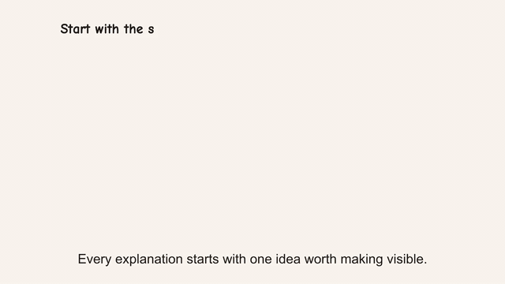

<div align="center">

# Explainer Video

**Turn text, web pages, and documents into narrated hand-drawn videos.**

[Website](https://speedpainter.org) · [Demo](https://cdn.jsdelivr.net/gh/SpeedPainterOrg/explainer-video@v0.5.1/assets/explainer-video-demo.mp4) · [Privacy](https://speedpainter.org/en/privacy) · [Support](https://speedpainter.org/en/contact)

</div>

<p align="center">
  <strong>English</strong> ·
  <a href="docs/README.zh-CN.md">简体中文</a> ·
  <a href="docs/README.ja.md">日本語</a> ·
  <a href="docs/README.es.md">Español</a>
</p>

## See it in action

[](https://cdn.jsdelivr.net/gh/SpeedPainterOrg/explainer-video@v0.5.1/assets/explainer-video-demo.mp4)

[Watch the full demo with narration and burned subtitles.](https://cdn.jsdelivr.net/gh/SpeedPainterOrg/explainer-video@v0.5.1/assets/explainer-video-demo.mp4)

## Install

```bash
npx --yes github:SpeedPainterOrg/explainer-video
```

The installer detects Codex and Claude Code automatically. Start a new agent
session after installing and complete Google sign-in if prompted.

## Make a video

```text
Create a 30-second explainer video about the history of the FIFA World Cup,
from the first tournament in 1930 to today.
```

You can provide text, a URL, or a document and choose the language, duration,
aspect ratio, voice, and subtitles. Sensible defaults are used when you
do not specify them.

## Privacy

- Your agent reads the original file locally; the file itself is not uploaded.
- Only the extracted content needed to create the video is sent to the service.
- You never need to provide an image, voice, storage, or renderer API key.

[Privacy Policy](https://speedpainter.org/en/privacy) · [Terms](https://speedpainter.org/en/terms) · [Support](https://speedpainter.org/en/contact) · [GitHub Issues](https://github.com/SpeedPainterOrg/explainer-video/issues)

## Documentation & Official Channels

- **Web Studio**: [SpeedPainter](https://www.speedpainter.org/en) · [AI Drawing Timelapse Generator](https://www.speedpainter.org/en/ai-drawing-timelapse-generator) · [Whiteboard Video Maker](https://www.speedpainter.org/en/whiteboard-video-maker) · [Doodle Video Maker](https://www.speedpainter.org/en/doodle-video-maker)
- **Developer Docs & Quickstart**: [Read the Docs](https://speedpainter.readthedocs.io/en/latest/) · [Explainer Video Skill Guide](https://www.speedpainter.org/en/skills/explainer-video) · [Go SDK on pkg.go.dev](https://pkg.go.dev/github.com/SpeedPainterOrg/speedpainter-go) · [Ecosystem Quickstart Gist](https://gist.github.com/SpeedPainterOrg/54ad806f07a575a92c4ce419a743493f)
- **Browser & Desktop Apps**: [Microsoft Store App](https://apps.microsoft.com/detail/9P7PJWG51H3P) · [Firefox Add-on](https://addons.mozilla.org/en-US/firefox/addon/speedpainter-whiteboard/) · [Microsoft Edge Add-on](https://microsoftedge.microsoft.com/addons/detail/jdlganhconpjiemflceikgmildnfjphp)
- **MCP Marketplace**: [LobeHub MCP Listing](https://lobehub.com/mcp/speedpainterorg-explainer-video)
